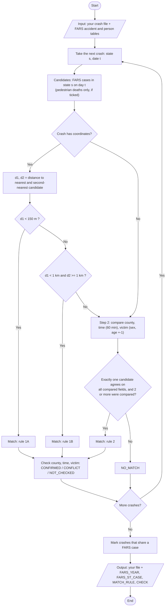

# State crash data to FARS: find the FARS case for each crash

This tool finds **the FARS case for each crash in a state crash file**. Give it your crash file (Excel or CSV, one row per crash) and the yearly FARS files from NHTSA, and it adds the FARS case number (`ST_CASE`) to every crash it can match, says which rule found it, and checks the match against fields the rule did not use.

FARS (the Fatality Analysis Reporting System) does not store the state crash ID. Its `ST_CASE` is a FARS number, so you cannot join FARS to a state crash file, or order a police report from a FARS case, by ID. The two files describe the same crash in the same terms, though: the state, the date, the place, the time, the county and the people killed. This tool links them on those terms, using two simple rules. On 5,467 Texas crashes checked against the full Texas crash database (CRIS), the matches agreed on time, county and victim more than 99% of the time.

**Contents:**
[Quick start](#quick-start-windows) ·
[Other ways to run it](#other-ways-to-run-it) ·
[What your crash file needs](#what-your-crash-file-needs) ·
[What you get](#what-you-get) ·
[The method](#the-method) ·
[How well it works](#how-well-it-works) ·
[Limits](#limits) ·
[Files in this repository](#files-in-this-repository)

---

## Quick start (Windows)

1. **Get Python.** Install [Anaconda](https://www.anaconda.com/download) (free). The first time you run the tool, it checks for the three packages it needs (`pandas`, `numpy`, `openpyxl`) and offers to install any that are missing.
2. **Get the FARS data.** Download the national CSV file for each year you need, for example `FARS2022NationalCSV.zip`, from the [NHTSA FARS download page](https://www.nhtsa.gov/file-downloads?p=nhtsa/downloads/FARS/), and put them in one folder. Do not unzip them.
3. **Double-click `RUN_ME.bat`.** A window opens. Pick your crash file, check the columns the tool guessed, pick the FARS folder, and press **Run**. You can also drag your crash file onto `RUN_ME.bat`.

The window asks four things:

| Box | What to do |
|---|---|
| 1. Your crash file | `.xlsx` or `.csv`, one row per crash. The first sheet is read. |
| 2. Which column holds what | The tool guesses from the column names. Change any guess that is wrong; pick "(not in my file)" for a field you do not have. If your file has no State column, pick the state in "Every row is in state". |
| 3. FARS folder | The folder with the `FARS<year>NationalCSV.zip` files. |
| 4. Output file | Where to write the result (`.xlsx` or `.csv`). |

Keep "Pedestrian deaths only" ticked if your file holds pedestrian deaths: the tool then matches only to FARS cases in which a pedestrian died, which rules out a nearby crash of another kind on the same day. Untick it for any other kind of fatal crash.

About 13,500 crashes in five states take less than a minute on a laptop.

## Other ways to run it

**Command line** (any operating system):

```bash
pip install -r requirements.txt
python fars_match.py --crashes my_crashes.xlsx --fars FARS_folder --out matched.xlsx
```

Columns are guessed from their names. Name a column yourself when the guess is wrong, for example `--time-col Crash_Time --county-col Cnty_ID`. Use `--state TX` when every row is in one state, and `--all-fatal` to match to any fatal crash rather than only pedestrian deaths.

**From your own Python code:**

```python
import fars_match as fm
out = fm.run("my_crashes.xlsx", "FARS_folder", "matched.xlsx")
print(out[["FARS_ST_CASE", "MATCH_RULE", "CHECK"]].head())
```

## What your crash file needs

| Field | Needed for | Accepted forms |
|---|---|---|
| Crash date | always | any date or date-time |
| State | always (or pick one state for every row) | name (`Texas`), postal code (`TX`) or FIPS code (`48`) |
| Latitude, longitude | Step 1 | decimal degrees |
| Crash time | Step 2 and the check | `18:50`, `6:50 PM`, `1850`, or a time inside the date column |
| County | Step 2 and the check | county name (`De Witt`, `DEWITT`, `De Witt County` all work) |
| Victim age and sex | Step 2 and the check | age in years; sex as `M`/`F`, `Male`/`Female` or `1`/`2` |
| Crash ID | optional | kept as it is in the output |

Step 1 needs coordinates. Step 2 needs at least two of county, time and the victim's age and sex. A file with coordinates only still gets Step 1; a file without coordinates can still be matched by Step 2.

**The victim must be the person who died.** If your crash file stores one "pedestrian" per crash, check that it is the pedestrian who was killed and not the first pedestrian or the second unit in the crash. A wrong victim does not create wrong matches in Step 1, but it makes the check report conflicts and makes Step 2 miss crashes.

## What you get

Your crash file comes back with these columns added on the right:

| Column | Meaning | Example |
|---|---|---|
| `FARS_YEAR` | FARS year of the matched case | `2022` |
| `FARS_ST_CASE` | FARS case number | `481234` |
| `MATCH_RULE` | Which rule found it (next table) | `1A_NEAREST_UNDER_150M` |
| `MATCH_DIST_M` | Distance in metres between your crash and the FARS case (Step 1) | `12` |
| `CHECK` | `CONFIRMED`, `CONFLICT` or `NOT_CHECKED` (see [the check](#the-check)) | `CONFIRMED` |
| `CHECK_NOTES` | What was compared | `county agrees; time agrees; victim agrees` |
| `TIME_GAP_MIN` | Minutes between your crash time and the FARS time | `0` |
| `SHARED_FARS_CASE` | `True` if another row of your file got the same FARS case | `False` |

| `MATCH_RULE` | Meaning |
|---|---|
| `1A_NEAREST_UNDER_150M` | Nearest FARS case on the same day, less than 150 m away |
| `1B_ONLY_CASE_UNDER_1KM` | Nearest FARS case on the same day, less than 1 km away, and no other FARS case within 1 km |
| `2_COUNTY_TIME_VICTIM` | The only FARS case on the same day that agrees on county, time and victim |
| `NO_MATCH` | No FARS case passed either rule |
| `NO_MATCH_YEAR_NOT_IN_FARS` | No FARS file for that year in the folder (for example, the newest year is not released yet) |
| `NO_MATCH_MISSING_STATE_OR_DATE` | The row has no usable state or date |

A second sheet, `Summary`, counts the rows by state and rule, and by rule and check.

---

## The method

The method rests on one fact about FARS and one fact about crashes.

1. **FARS is a census of fatal crashes, built from the same police reports as the state file.** A fatal crash in a state crash file should therefore also be in FARS, on the same date, at the same place, at the same time, with the same people killed. FARS gives each crash its own number (`ST_CASE`) and does not keep the state's crash ID.
2. **Two fatal crashes rarely happen at the same place on the same day.** Fatal pedestrian crashes are rarer still. So within one state and one day, location alone usually picks out a single FARS case; and when location is missing or unclear, county, time and the victim's age and sex do.

Put together: look only at FARS cases in the same state on the same day, take the one at the same place, and when that fails, take the one that agrees on county, time and victim. Then check every match on the fields the rule did not use.

### Background: the FARS fields the tool uses

| FARS table | Field | Meaning |
|---|---|---|
| `accident` | `STATE`, `ST_CASE` | State FIPS code and FARS case number. `ST_CASE` starts with the state code and is unique within a year, so a FARS case is `YEAR` + `ST_CASE`. |
| `accident` | `YEAR`, `MONTH`, `DAY` | Crash date |
| `accident` | `HOUR`, `MINUTE` | Crash time; 99 means unknown |
| `accident` | `LATITUDE`, `LONGITUD` | Crash location; 77.7777, 88.8888 and 99.9999 mean not reported or unknown |
| `accident` | `COUNTY`, `COUNTYNAME` | County FIPS code, and its name from 2018 on |
| `person` | `PER_TYP`, `INJ_SEV` | Person type (5 = pedestrian) and injury (4 = fatal) |
| `person` | `AGE`, `SEX` | Age in years (998 and 999 = unknown); sex |

The full definitions are in NHTSA's *FARS Analytical User's Manual*, published with the data.

### Step 0: read the FARS cases

For each year, read the `accident` and `person` tables. Keep the cases in your states and years. With "Pedestrian deaths only", keep only the cases with at least one person with `PER_TYP` = 5 and `INJ_SEV` = 4, and call those people the victims; otherwise, every person with `INJ_SEV` = 4 is a victim.

Unknown values are set aside, not treated as values: a time with `HOUR` or `MINUTE` = 99, coordinates of 77.7777, 88.8888 or 99.9999, and ages of 998 or 999. In your file, a time of exactly 00:00 is treated as unknown, because many crash files use it as a placeholder.

### Step 1: match by location

For a crash with date $t$ in state $s$ at latitude $\varphi$ and longitude $\lambda$, the candidates are the FARS cases in state $s$ on day $t$ that have a location. For each candidate $j$ at $(\varphi_j, \lambda_j)$, the distance in metres is

$$
d_j = \sqrt{\big(111{,}320\,\cos\varphi\,(\lambda_j - \lambda)\big)^2 + \big(110{,}540\,(\varphi_j - \varphi)\big)^2}
$$

which is accurate to well under 1% at these distances. Sort the candidates by distance, so $d_{(1)}$ is the nearest and $d_{(2)}$ the second nearest. Then:

$$
\text{match} =
\begin{cases}
\text{nearest case (rule 1A)} & \text{if } d_{(1)} < 150\ \text{m} \\
\text{nearest case (rule 1B)} & \text{if } d_{(1)} < 1{,}000\ \text{m and } d_{(2)} \ge 1{,}000\ \text{m} \\
\text{no match from Step 1} & \text{otherwise}
\end{cases}
$$

Rule 1A takes the case that is clearly at the same place. Rule 1B allows for a crash file and FARS placing the same crash a few hundred metres apart, but only when there is no other fatal case anywhere near that could be the right one.

### Step 2: match by county, time and victim

Step 2 runs only for crashes Step 1 did not match. The candidates are again the FARS cases in the same state on the same day. For each candidate, compare whatever both sides have:

| Field | Agrees when |
|---|---|
| County | same name, ignoring case, spaces, punctuation and the word "County" |
| Time | the two times are 60 minutes or less apart |
| Victim | one of the FARS victims has the same sex and an age within 1 year (where both are known) |

A candidate passes if **at least two fields could be compared and all of them agree**. Step 2 accepts a match only when **exactly one** candidate passes. If none passes, or more than one does, the crash stays unmatched.

### The check

Every match is then compared on county, time and victim, wherever both sides have them:

- `CONFIRMED`: every field that could be compared agrees.
- `CONFLICT`: at least one field disagrees. Look at these rows.
- `NOT_CHECKED`: the crash file has none of these fields.

For Step 1 matches the check is an independent test, because Step 1 uses only date and location. For Step 2 matches every compared field agrees by design, so their check is always `CONFIRMED`; Step 2 is tested separately (see [How well it works](#how-well-it-works)). A time exactly 12 hours off is reported as "time off by 12 h (AM/PM)" and not as a conflict, because it is a common data-entry slip.

Finally, if two rows of your file match the same FARS case, both are kept and marked `SHARED_FARS_CASE`. That usually means the crash file holds the same crash twice.

### A worked example

FARS has three pedestrian cases in Texas on 1 May 2022 (made-up data; the same example is checked by `tests/test_match.py`):

| FARS case | Place | Time | County | Victim |
|---|---|---|---|---|
| 480001 | 30.0000, -97.7400 | 18:50 | Travis | male, 45 |
| 480002 | 30.2000, -97.7400 | 09:00 | Travis | female, 30 |
| 480003 | 30.5000, -97.7400 | 21:05 | Williamson | male, 62 |

| Your crash | Step 1 | Step 2 | Result |
|---|---|---|---|
| A: 30.0009, -97.7400 | 480001 is 100 m away: under 150 m | not needed | 480001, `1A` |
| B: 30.5050, -97.7400 | 480003 is 553 m away; next case is 33 km away | not needed | 480003, `1B` |
| C: no coordinates; Travis, 09:20, female, 31 | no location | 480002 agrees on county, time (20 min) and victim; 480001 fails on time and victim | 480002, `2` |
| D: no coordinates; Travis only | no location | only one field: not enough | `NO_MATCH` |

### Flowchart



### Pseudocode

```text
Algorithm 1: Match state crashes to FARS cases
Input : crashes C (state, date, and any of: lat, lon, time, county, victim age and sex)
        FARS cases F (state, date, lat, lon, time, county, victims)
Output: FARS case, rule and check for each crash

for each crash c in C:
    K <- { f in F : f.state = c.state and f.date = c.date }          # same state, same day
    match <- none
    if c has coordinates:                                            # Step 1
        sort K by distance d to c;  d1, d2 <- two smallest distances
        if d1 < 150 m:                     match <- nearest, rule 1A
        else if d1 < 1000 m and d2 >= 1000 m: match <- nearest, rule 1B
    if match = none:                                                 # Step 2
        P <- { }
        for each f in K:
            tests <- comparisons available among
                     county(c) = county(f);  |time(c) - time(f)| <= 60 min;
                     some victim v of f with sex(v) = sex(c) and |age(v) - age(c)| <= 1
            if size(tests) >= 2 and all tests true: add f to P
        if size(P) = 1: match <- the case in P, rule 2
    if match != none:
        check <- CONFIRMED if every available comparison agrees, CONFLICT if any disagrees,
                 NOT_CHECKED if none is available
mark crashes whose match is shared with another crash
```

---

## How well it works

We tested the tool on a file of 13,529 fatal pedestrian crashes from Alabama, Georgia, Michigan, Ohio and Texas (2015 to 2025), against the FARS national files for 2015 to 2024. For Texas we added the crash time, the county and the killed pedestrian's age and sex from the full Texas crash database (CRIS, 2017 to 2025). CRIS is confidential; only summary numbers are reported here.

**How many crashes matched.**

| State | 1A | 1B | 2 | No match | 2025 (FARS not released) | Total |
|---|---|---|---|---|---|---|
| Alabama | 628 | 142 | 0 | 141 | 96 | 1,007 |
| Georgia | 2,013 | 206 | 0 | 267 | 252 | 2,738 |
| Michigan | 1,249 | 19 | 0 | 128 | 0 | 1,396 |
| Ohio | 1,101 | 96 | 0 | 89 | 0 | 1,286 |
| Texas | 5,719 | 377 | 94 | 223 | 689 | 7,102 |
| **Total** | **10,710** | **840** | **94** | **848** | **1,037** | **13,529** |

Of the 12,492 crashes in years FARS covers, 11,644 (93.2%) matched. 137 of the unmatched crashes have no usable coordinates and nothing else to match on (Michigan 82, Alabama 49 with coordinates of -1/-1, Georgia 3, Texas 3).

**Are the matches right?** Step 1 uses only the date and the location, so time, county and victim are an independent test of it.

| State | Rule | Checked | Confirmed |
|---|---|---|---|
| Texas | 1A | 5,165 | 5,138 (99.5%) |
| Texas | 1B | 302 | 297 (98.3%) |
| Michigan (time only) | 1A | 1,245 | 1,244 (99.9%) |
| Michigan (time only) | 1B | 19 | 19 (100%) |

In Texas, the FARS time and the CRIS time were the same to the minute for 99.5% of Step 1 matches (5,453 with both times). Of the 33 conflicts across both rules, 20 agree on county and on time within one minute and differ only in the victim's age or sex, which points to a typing error in one of the files rather than a wrong crash; 10 differ only in county, at county borders. Another 15 matches had the time exactly 12 hours off (AM/PM).

In Alabama, Georgia and Ohio the crash file has no time, county or victim to check against. There, the posted speed limit in FARS and in the state crash data were the same for 96.6% (Alabama), 97.1% (Georgia) and 97.1% (Ohio) of matched crashes, against 98.6% in Michigan and 99.4% in Texas.

**Is Step 2 right?** Step 2 matches on county, time and victim, so those fields cannot test it. Instead we took the 5,467 Texas crashes that Step 1 had matched, hid their coordinates, and ran Step 2 alone:

| Step 2 result | Crashes | Share |
|---|---|---|
| Found the same FARS case as Step 1 | 5,376 | 98.3% |
| No single candidate (left unmatched) | 90 | 1.6% |
| Found a different FARS case | 1 | 0.02% |

When Step 2 gives an answer, it is the same answer as Step 1 99.98% of the time. In the full run, Step 2 matched 94 Texas crashes that Step 1 had missed: 86 were placed more than 1 km apart in the crash file and in FARS, and the rest had no coordinates on one side.

**Duplicates.** 46 crashes in the test file (23 pairs) matched a FARS case that another crash also matched. Most pairs have the same date and place and consecutive crash IDs, so the crash file most likely holds those crashes twice.

## Limits

- **New years.** FARS is released about a year and a half after the crash year. Crashes from years not yet in FARS cannot be matched.
- **No coordinates and no other fields.** A crash without coordinates needs at least two of county, time and victim for Step 2.
- **Border counties.** A crash on a county line can be in one county in the crash file and the next county in FARS. Step 2 then misses it (about 10 in 5,467 in the Texas test).
- **Wrong victim in the crash file.** If the crash file's victim is not the person killed (for example, the second unit of every crash), the check reports false conflicts and Step 2 misses crashes. Check your victim fields first.
- **Crashes stored twice.** Two rows of your file can match one FARS case. They are marked, not removed: only you can tell which row to keep.
- **Several victims.** The victim test passes if any of the FARS case's victims agrees.
- **Rule 1B is a little weaker than 1A** (98.3% against 99.5% confirmed in Texas). Filter on `MATCH_RULE` if you need the strictest set.

## Files in this repository

```
RUN_ME.bat             double-click to open the window (Windows)
fars_match_gui.py      the window
fars_match.py          the method; also a command-line tool and an importable module
tests/test_match.py    a small synthetic test (python -m pytest tests)
requirements.txt       packages for pip
environment.yml        the same for conda
LICENSE                MIT license
```

No crash data or FARS data are stored in this repository. Download FARS yourself from NHTSA.

## Requirements

Python 3.10 or newer with `pandas`, `numpy` and `openpyxl`.

## References

- NHTSA. *Fatality Analysis Reporting System (FARS)*, national CSV files and the *FARS Analytical User's Manual*. https://www.nhtsa.gov/file-downloads?p=nhtsa/downloads/FARS/

## License

MIT. See [LICENSE](LICENSE).

## How to cite

If you use this tool, please cite it as:

Rafe, A. (2026). *State crash data to FARS matching* (Version 1.0.0) [Computer software]. Texas State University. https://github.com/pozapas/fars-crash-match

```bibtex
@software{rafe2026farsmatch,
  author  = {Rafe, Amir},
  title   = {State crash data to FARS matching},
  version = {1.0.0},
  year    = {2026},
  url     = {https://github.com/pozapas/fars-crash-match}
}
```

## Author

Amir Rafe, Texas State University
